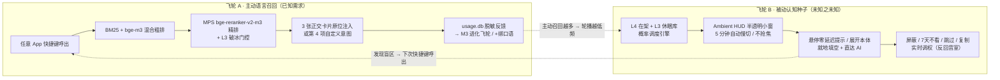

<div align="center">

# ✨ Glint（微光）

**macOS 系统级常驻认知路由器与被动破盲引擎**  
*OS-Level Cognitive Router & Ambient Discovery Engine for Apple Silicon*

[](https://github.com/liamamilin/Glint)
[](https://github.com/liamamilin/Glint)
[](#隐私与安全红线)
[](#实机性能与评测基准)
[](LICENSE)

</div>

---

## 为什么做 Glint？

和 AI 协作时，人面临两种完全不同、却同样高频的瓶颈：

1. **已知意图，但懒得现写好指令**：心里知道要“拆解架构 / 核验假设 / 对齐验收标准”，却总是在输入框里随手打出低质量短句。
2. **未知之未知（Unknown-Unknowns）**：你甚至不知道某个认知视角或方法论的存在，自然永远不会主动去搜它。

**Glint** 不是又一个聊天窗口，而是潜伏在 macOS 操作系统里的**双飞轮认知基础设施**——平时隐形，需要时快捷键呼出即现加载反馈，并在本地完成两阶段检索后原位浮现 3 张正交认知卡片；闲时在桌面角落以不抢焦的半透明磨砂小窗，缓慢播撒来自全库的「认知种子」。

---

## 双飞轮架构全景



---

## 实机产品截图

**个人认知卡片空间 · 从一句日常想法，到三个互补的思考视角**


<table>
  <tr>
    <td width="50%" align="center" valign="top">
      <strong>卡片详情 · 适用场景、常用说法与完整指令</strong><br/><br/>
      
    </td>
    <td width="50%" align="center" valign="top">
      <strong>桌面陪伴 · 认知种子与陪伴节奏</strong><br/><br/>
      <br/><br/>
      
    </td>
  </tr>
</table>

---

## 核心特性

### 1. 主动语义路由（Flywheel A）
- **系统级无感交互**：在 Cursor、VS Code、Notion、Obsidian、飞书、浏览器等任意应用中，双击右 `Option`（可自定义快捷键）原位弹出非激活浮窗（抓到文本即现加载反馈），**绝不抢走焦点与光标**；数字键 `1–3` / `↵` 直接追加或包裹注入，继续打字自动收起。
- **两阶段本地检索（不截断用户口语）**：`BM25 + Ollama bge-m3` RRF 混合粗排 → 本地 Apple Silicon MPS `BAAI/bge-reranker-v2-m3`（FP16 单线程串行执行器）精排，剥离“去 AI 味 / 只给表格”等风格修饰语，并保留卡片全部用户口语按当前输入相关性动态前置。
- **L3 破冰门控（Breakthrough Gate）**：未上架到 L4 的休眠知识库（如 CLE 扩展接口、ATLAS 方法论）在命中足够强时，自动以 `✦ L3 发现` 紫色角标穿透展示，既保高信噪比又不埋没长尾好卡。
- **多动作协议与工作流衔接**：支持 `inject_prompt`（注入）、`show_checklist` / `open_resource`（轻阅读浮窗不覆盖输入），并自动按 App 记忆多步工作流上下文（`→ 下一步`）。

### 2. 认知种子 Ambient HUD（Flywheel B）
- **一直在，但不打扰**：基于 `.nonactivatingPanel` 的可拖拽半透明磨砂小窗，**背景通透度与文字对比度解耦**——余光扫一眼即清晰可读，悬停才浮出微操作条与零延迟内联中文提示。
- **概率调度引擎（Spaced-Discovery + 重点聚焦轮播）**：
  - L4 按 `Tier S (4.0) > Tier A (2.0) > Tier B (1.0)` 加权，默认 **全域智能混播** 为 L3 休眠库保留 **~15%** 探索预算；支持将单卡或整个专题包一键 `📌` 钉入「重点聚焦」队列（智能混播默认占 **30%** 配额，支持自适应冷却）；菜单栏支持 **5 种模式**自由切换（`全域智能混播 / 仅看重点聚焦 / 仅 L4 在架 / 仅 L3 休眠探索 / 仅 S 级核心`）。
  - **反回音室衰减**：联动 `usage.db` 近 30 天主动召回次数，你越常主动召回的卡，在桌面轮播里出现越少，把注意力留给真正还没内化的盲区。
  - **零成本屏蔽与撤销**：点击「不再轮播 / 7 天不看」立即切卡并弹出 4.5 秒「撤销」条；**屏蔽仅移出轮播，完全不影响快捷键主动召回**，解除屏蔽后原钉选状态自动保留。
- **增强阅读卡**：点击卡片正文展开完整本体，自动识别 `[...]` / `【...】` / `{{...}}` 变量支持**就地填空**，一键复制或直接带入打开 **ChatGPT / Claude / Gemini**，按 `Esc` 收起。

### 3. 五层认知供应链与个人认知管理空间
- **五层管线**：`L0 原始文本 → L1 资产快照 → L2 结构化透镜 → L3 清洗总库存（公开基线 478 张；叠加本地可选私有 meta-vault 共 484 张） → L4 声明式上架货架（413 张，含 89 张 Tier S 常青底座 + 71 张 L3 休眠待命）`，原子构建、秒级热加载与一键回滚。
- **CLE v0.7 底座**：内置认知语言工程（CLE v0.7）全量 82 项精炼接口（去术语化，外部 LLM 零门槛可执行），其中 27 项「结构核心 + 模糊态/分类扩展」作为 Tier S 常青底座，叠加 `discovery-taxonomy`（106）、`prompt-taxonomy`（221）、`super-individual-toolbox`（36）、`atlas-methods`（16）、`glint-core`（9+）与个人自建卡。
- **闪电导入、血缘归档与个人空间（`http://127.0.0.1:18765/admin/`）**：直接挂载于 `brain-server`（零额外进程），菜单栏支持 `Glint 管理…` 与 `⚡ 从剪贴板导入认知卡…` 一键直达。默认呈现 5 大日常视图（**首页与实时试用 / 我的卡片库 / 桌面陪伴节奏 / 制作新卡片 / 使用回顾**），支持 `🕒 最新添加` 排序、单卡级专题包多选管理、Markdown/YAML 闪电粘贴导入与双向演进血缘归档（升级替换旧卡自动 `deprecated` 归档可回溯）；左下角开启 **开发者模式** 可展开 **召回排序诊断 / 黄金评测与素材库 / 底层 YAML 与脱敏日志**（支持 `🔒 私库` 徽标与 `meta-vault/` 物理隔离覆写）。

---

## 实机性能与评测基准

基于 34 条核心回归样本（[golden_cases.yaml](recognition-library/eval/golden_cases.yaml)）及 108 条开源扩展日常/模糊压测集（[everyday_simulated.yaml](recognition-library/eval/datasets/everyday_simulated.yaml) + [vague_ambiguous_stress.yaml](recognition-library/eval/datasets/vague_ambiguous_stress.yaml)）在 Apple Silicon 本机实测：

| 指标 | Golden Eval (34) | 日常模拟 (72) | 模糊高歧义 (36) | 说明 |
| --- | :---: | :---: | :---: | --- |
| **Hit@1** | **97.1%** (33/34) | **95.8%** | **72.2%** | 首卡即命中预期透镜 |
| **Hit@3** | **100.0%** (34/34) | **100.0%** | **91.7%** | Top 3 覆盖率 |
| **Forbidden Rate** | **0.0%** | **1.4%** | **0.0%** | 跨领域串台误召回控制 |
| **Orthogonality** | **100.0%** | **100.0%** | **100.0%** | 3 卡严格正交覆盖不同元操作 |
| **单元测试** | **30/30 Passed** | — | — | `brain-server` (17) + `recognition-library` (13) |

---

## 项目结构

```text
Glint/
├── macos-app/              # SwiftUI + AppKit 菜单栏常驻端（快捷键、三卡浮窗、认知种子 HUD）
├── brain-server/           # FastAPI 本地路由后端（18765：混合召回、MPS 精排、种子概率引擎、/admin）
├── recognition-library/    # 五层认知供应链（L0→L4 管线、CLE/Taxonomy 资产、管理台 UI、Golden Eval）
├── meta-vault/             # 可选本地私有二阶元认知仓（受 .gitignore 隔离，不提交至公开仓库）
├── training/               # 本地 Apple MLX LoRA 微调预留目录（按需手动触发）
└── docs/                   # 文档与唯一权威来源索引（INDEX.md）、截图资源及历史归档（archive/）
```

---

## 快速启动（macOS 14+ Apple Silicon）

### 1. 环境准备
- macOS 14+（Apple Silicon，建议 16GB+ 内存）
- Python 3.10+、Swift / Xcode Command Line Tools
- [Ollama](https://ollama.com/) 本地运行并拉取模型：
  ```bash
  ollama pull bge-m3:latest
  ollama pull qwen3.5:2b
  ```

### 2. 启动本地后端（`brain-server`，端口 `18765`）
```bash
cd brain-server
pip install -e .
# 推荐：安装为 macOS launchd 开机自启后台服务
./scripts/install_launchd.sh
# 或前台调试运行：
uvicorn main:app --host 127.0.0.1 --port 18765
```
启动后访问统一管理台：`http://127.0.0.1:18765/admin/`

### 3. 编译、签名并启动 macOS 客户端
```bash
./macos-app/scripts/build_and_run.sh
```
首次启动后在系统设置中授予 Glint **辅助功能（Accessibility）** 权限，即可在任意应用中双击右 `Option` 呼出认知卡片，屏幕右下角会自动出现半透明的「认知种子」小窗。

### 4. 运行测试与黄金评测
```bash
# 后端与供应链单元测试
cd brain-server && pytest -q
cd ../recognition-library && pytest -q

# 34 题黄金回归评测（需 brain-server 运行中）
python3 eval/run_eval.py
```

---

## 隐私与安全红线

- **100% 本地推理**：所有向量检索、MPS Cross-Encoder 精排与路由决策均在本机完成，不向外部云端发送你的输入上下文。
- **敏感场景静默忽略**：自动识别密码框（`AXSecureTextField`）及 1Password、Bitwarden、Keychain 等敏感应用，严格保持隐形不读取。
- **落盘前脱敏**：`usage.db` 写入前自动正则擦除 `sk-`/`sk_live_` 等 API Key、JWT、Bearer Token、URL 内嵌凭据、中英文密码键值与手机号；`usage.db`、`seed_state.json`、`meta-vault/` 与 `dist/` 均已加入 `.gitignore`，永不提交到公开代码仓库。

---

## 进阶文档

- 文档总览与唯一权威来源（SSOT）索引：[docs/INDEX.md](docs/INDEX.md)
- 架构总纲与双飞轮设计（SSOT）：[recognition-library/design.md](recognition-library/design.md)
- 演进路线图与 TODO 备忘：[recognition-library/roadmap.md](recognition-library/roadmap.md)
- 初版设计备忘（已归档）：[docs/archive/glint_v0.1_notes.md](docs/archive/glint_v0.1_notes.md)

## License

[MIT](LICENSE)
