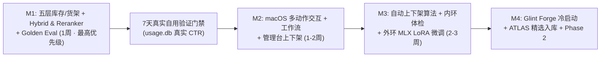

# Glint（微光）开发计划与演进路线图 (v2.5)

> **文档定位**：基于 [design.md](design.md) 架构总纲、实机运行数据与红队深度复盘，固化 **五层认知供应链（`L0 → L1 → L2 草稿 → L3 库存 → L4 上架`）**、**三维立体组织（`Tier S/A/B × 二级领域树 × 自定义专题包 × 声明式 L4 货架`）**、**高精路由（Hybrid Recall + `bge-reranker-v2-m3` + L3 破冰门控）** 与 **双飞轮（主动语言召回 + 被动认知种子 Ambient HUD）** 的分阶段落地方案。

---

## 一、核心架构演进（红队深度复盘结论）

在跑通首批 387 张透镜与 `macos-app` 实机联调后，我们通过真实 Bad Case（如 `"我想要调研一下区块链"`）识别出 4 个结构性升级点，已全部纳入 v2.2 规划：

1. **五层供应链与双货架隔离（根治垂直卡串台）**
   - 将原 L3 拆分为 **L3 生产透镜库存（Inventory，合格可用但不一定上架）** 与 **L4 生产上架透镜（On-Shelf = `dist/current`，真正参与线上路由）**。
   - L4 货架分为两类：
     - **常青通用货架（`scope: universal`，精选 40–60 张）**：跨领域高频认知底座，**永不下架**，哪怕阶段性少用也稳稳兜底基础体验。
     - **动态垂直货架（`scope: domain_specific`）**：按领域/热度/使用频率**动态上下架**——长期不用或高曝光零点击自动下架回 L3 库存（不删数据），进入新领域或触发相关摩擦时一键/自动重新上架。
   - **战略收益**：L3 库存可以持续扩充（包括从 `ATLAS-METHODS` 精选可用技能），**完全不影响 L4 线上路由的信噪比与延迟**。
2. **极速精排替代重型 2B 生成（延迟从 850ms 压回 < 250ms）**
   - 本地已下载 **`hans-tech/bge-reranker-v2-m3:260522`**（1.2 GB），配合 **BM25 + `bge-m3` 混合粗排** 做两阶段检索，解决双塔向量对短中文动作词不敏感、以及 2B 生成 JSON 精排耗时过高（750–850ms）的双重瓶颈。
3. **`L2 → L3` 注入语境人称清洗（消除模板拼接味）**
   - 自动将 `Prompt-taxonomy` 等模板中的第三人称表述（如“请把用户提供的问题作为调研对象”）清洗为自然的对话衔接（如“请基于我上面提到的内容…”），并控制注入正文精炼度。
4. **7 天真实自用验证门禁（防过度设计）**
   - 在投入 M3 本地 MLX LoRA 微调与 M4 生态引擎前，必须先靠 M1 的双层货架 + 极速精排把体感打穿，通过本人 **连续 7 天真实自用（`usage.db` 真实 CTR 与日均呼出）** 验证核心假设。

---

## 二、当前基线盘点（v2.5 · 双飞轮 + 重点聚焦轮播 + 闪电导入/血缘归档 + 零损提速）

> 详细架构规范与策略定义见唯一权威来源 [design.md](design.md)；文档导航见 [docs/INDEX.md](../docs/INDEX.md)。

- **五层库存与三维组织（`20261128_131522_518242d6`）**：
  - **公开库基线（Git 追踪）**：L2 **478 张**（含 `prompt-taxonomy: 221`、`discovery-taxonomy: 106`、`cle-v0.7: 82`、`super-individual-toolbox: 36`、`atlas-methods: 16`、`glint-core: 9`、`manual-custom: 7`、`user-friction: 1`）。
  - **本机完整运行态（含 `.gitignore` 隔离的私有 `meta-vault/` 6 张二阶卡）**：L3 总库存 **484 张**、L4 线上货架 **413 张**（**89 张 Tier S 常青** + **324 张 `on_shelf` 动态上架卡**）、L3 休眠待命 **71 张**（55 张 CLE 扩展接口 + 16 张 `atlas-methods`）、隔离区 **3 张**。
- **双飞轮实机运行**：
  - **飞轮 A（主动语言召回）**：`brain-server`（`v2_hybrid_rerank`，`18765` 常驻）+ 保留全部口语按相关性前置 + 统一标度 Stage-2 评分与 L3 破冰门控 + 语义/续接工作流门控 + 前端 `ContextReader` 10ms 精细轮询与即时加载态浮窗；
  - **飞轮 B（被动认知种子）**：macOS 原生半透明 Ambient HUD（每 5 分钟概率抽样、背景/文字分离余光可读、零延迟内联中文提示、4.5s 防误触撤销条、增强阅读卡就地填空与直达 ChatGPT/Claude/Gemini）+ 重点聚焦轮播（`pinned_ids`、`pinned_only`、`30%` 智能配额、自适应冷却、单卡/专题包一键 `📌` 钉入）+ 菜单栏 **5 种模式**自由切换。
- **统一管理台与测试**：`http://127.0.0.1:18765/admin/`，由 `/Applications/Glint.app` 菜单栏 `Glint 管理…` 与 `⚡ 从剪贴板导入认知卡…` 一键直达；支持 `🕒 最新添加` 排序、单卡级专题包多选与重命名、闪电粘贴导入、双向演进血缘归档与 `🔒 私库` 物理隔离；全量单测 **30/30** 通过（`brain-server` 17/17 + `recognition-library` 13/13）。
- **实机评测成绩（`413` 卡版）**：
  - **Golden Eval（34 题）**：`Hit@1 = 97.1%`、`Prim@1 = 100.0%`、`Orthogonality = 100.0%`（注：新增自建卡「主动证伪」在 `critique_fact_check` 排至第 1 位，导致旧 `expected_ids` 口径 `Hit@3 = 97.1%`）；
  - **`meta-vault` 二阶专项集（40 题）**：`Hit@1 = 92.5%`、**`Hit@3 = 97.5%`**、`Forbidden = 2.5%`、`Orthogonality = 100.0%`（Bad Cases 降至 1 条）。
- **本地模型分工**：`bge-m3:latest`（Ollama 粗排，P50 ~24–40ms）+ `BAAI/bge-reranker-v2-m3`（`torch` MPS FP16 进程内单线程精排，P50 ~586–711ms）；`qwen3.5:2b` 保留为 Stage 2B 降级兜底与 Phase 2 生成类微技能主力。

---

## 三、分阶段开发路线图（M1 → M4）

---

### Milestone 1：五层货架落地、极速精排与黄金评测门禁（✅ 已完成并超额达标）

> **核心目标**：建立评测尺子，上线 L3 库存 / L4 上架双货架机制与 `BAAI/bge-reranker-v2-m3`（MPS）极速精排。

* **任务 1.1（已完成）**：构建 [golden_cases.yaml](file:///Volumes/个人资料/2026/开发项目/Glint/recognition-library/eval/golden_cases.yaml) 与 [run_eval.py](file:///Volumes/个人资料/2026/开发项目/Glint/recognition-library/eval/run_eval.py)。
* **任务 1.2（已完成）**：落地 `shelf_policy.yaml` 双货架（45 张常青 `evergreen` + 326 张 `on_shelf` + 16 张 `off_shelf`）、`L2 → L3` 第三人称语境清洗，以及管理台货架筛选与一键切换。
* **任务 1.3（已完成）**：上线 **BM25 + `bge-m3` RRF 混合粗排 + 风格修饰语剥离 + MPS `BAAI/bge-reranker-v2-m3` raw logit 精排**（实机达成 `Hit@1 91.7%`、`Hit@3 100%`、`P95 352 ms`、`0` 误召回）。

---

### Milestone 2：多动作交互闭环与管理台货架运营（✅ 已完成）

> **核心目标**：补齐 `macos-app` 多动作交互断点，接通多步工作流衔接，并在管理台支持一键上下架 L3/L4 货架。

* **任务 2.1（已完成）**：`macos-app` 实现多动作协议分流——`inject_prompt` 保持极速追加/包裹注入；`show_checklist`（106 张破盲卡）与 `open_resource`（36 件兵器）点击后切换为 **`LensReaderView` 轻阅读浮窗**（不覆盖输入框，支持 `↵` 一键复制、`⇧↵` 按需注入、`Esc` 关闭）。
* **任务 2.2（已完成）**：在 `l2_to_l3.py` 确定性挂载 `Prompt-taxonomy` 全部 19 条多步工作流（89 张透镜写入 `execution.workflow`）；`brain-server` 新增按 App 隔离的 10 分钟 TTL 会话态，命中后在 Slot 1 自动置顶并展示 **`→ 下一步`** 蓝色角标。
* **任务 2.3（已完成）**：管理台（已统一挂载于 `brain-server` `18765/admin/`，另保留 `18770` 独立调试启动端口）已支持 `evergreen` / `on_shelf` / `off_shelf` 三态筛选、Overlay 隔离调校与一键发布。

---

### Milestone 3：动态上下架自进化算法与本地微调飞轮（✅ 工程已就绪，MLX 微调按约定暂缓执行）

> **核心目标**：让真实使用数据驱动垂直货架自动吐故纳新，并在日志充足后按需导出数据微调本地路由模型。

* **任务 3.1（已完成）**：落地 [evolution.py](file:///Volumes/个人资料/2026/开发项目/Glint/recognition-library/pipeline/evolution.py) 并接入管理台「进化飞轮」模块：
  * 实时消费 `brain-server/data/usage.db` 计算 CTR、`Esc` 逃逸率、P50/P95 延迟、App 分布与 Top 卡片榜；
  * **动态垂直货架体检**：严格豁免 `Tier S / evergreen` 卡，对高曝光低点击的垂直卡提出「下架回 L3」提案，对命中 `Esc` / `custom_intent` 的 L3 库存卡提出「上架 L4」提案，支持一键采纳；
  * **摩擦转草稿**：针对 `custom_intent` 痛点一键调用 OpenCode Go 生成新卡草稿入 L2/L3。
* **任务 3.2（数据导出已就绪，暂不微调）**：管理台支持一键导出脱敏后的 **SFT JSONL 微调数据集**；按计划待 7 天真实自用攒满 ≥ 300 条正负反馈后，再按需在 48GB Mac 上启动 Apple MLX LoRA 微调。

---

### Milestone 4：`Glint Forge` 冷启动与 `ATLAS-METHODS` 精选供给（✅ 供给工坊已落地）

* **任务 4.1（已完成）**：落地 [forge.py](file:///Volumes/个人资料/2026/开发项目/Glint/recognition-library/pipeline/forge.py) 与管理台「L0-L2 供给工坊」模块：
  * **`ATLAS-METHODS` 按主题检索精选**：支持按关键词检索本地 `records.jsonl`，勾选目标条目经 Gate 1–3 洗净存入 **L3 库存（默认 `off_shelf` 不污染 L4）**；
  * **L0 原始文本直接投喂**：粘贴文章/笔记直接走 `L0 → L1 → L2` 异步编译；
  * **零原料 `Glint Forge` Starter Pack**：输入目标领域与痛点，一键逆向合成覆盖 7 大认知原语的领域起手包，并自动装配为可一键开关的自定义专题包（Collection）；
  * **手工新建卡片**：支持在管理台直接表单新建卡片入库。
* **任务 4.2（Phase 2 预留）**：按需点亮 `instant_summary`（划词秒速摘要/日志排障）与 `local_lookup`（本地笔记/命令/系统钥匙串模糊唤醒）。

---

### Milestone 5：双飞轮收口——「认知种子」Ambient HUD 与 CLE v0.7 底座（✅ 已完成并上线）

* **任务 5.1（已完成）**：完成 CLE v0.7 全量 **82 张**认知接口手工精炼入库（无内部术语），并将 CLE 结构核心（27 项）与 `glint-core` 通用思考底座（9 项）纳入 `shelf_policy.yaml` 的 `evergreen_ids`，同时将私有二阶元认知资产体系（`meta-vault/`）接入独立私有仓库与本地隔离构建管线。
* **任务 5.2（已完成）**：上线 **L3 破冰门控**、管理台全库召回诊断 / `+绑口语` 实时校准 / 认知缺口持久化，并将精排触发口语窗口扩展至 6 条。
* **任务 5.3（已完成）**：落地 **认知种子（Glint Seed）** 双端闭环——macOS 原生非激活半透明 Ambient HUD（5 分钟自动切换、背景/文字分离余光可读、零延迟内联中文提示、4.5s 撤销条、增强阅读卡就地填空 + 一键直达 ChatGPT/Claude/Gemini）+ 服务端概率调度引擎（`seed_store.py`）+ 管理台第 7 模块「认知种子」控制面板。

---

### Milestone 5.5：二阶闭环完善、重点聚焦轮播与零损体验提速（✅ 已完成并上线）

* **任务 5.5.1（已完成）**：补齐 `meta-vault/` 6 张二阶元认知卡片（全部升级为保留「有效原因 / 适用条件 / 例外边界」），并落地私有专题包读写隔离与 40 题评测集。
* **任务 5.5.2（已完成）**：上线 **认知种子重点聚焦轮播**（`pinned_ids`、`pinned_only`、`30%` 配额、自适应冷却、菜单栏 5 模式切换）与管理台单卡/专题包 `📌` 钉入。
* **任务 5.5.3（已完成）**：上线 **闪电粘贴 YAML 导入**（含菜单栏 `⚡ 从剪贴板导入认知卡…`）、**双向演进血缘归档**（`supersedes` / `superseded_by` / `evolution_note` + Overlay `deprecated`）、`🕒 最新添加` 排序与单卡级专题包管理。
* **任务 5.5.4（已完成）**：定位快捷键延迟瓶颈（`bge-reranker-v2-m3` 占后端 95.4% + 浏览器无选区剪贴板回退），在不牺牲任何质量的前提下移除 7 条口语硬截断、优化 `ContextReader` 10ms 轮询（Chrome 抓取 `250ms → 150ms`）并上线即时加载态浮窗。

---

## 四、当前 TODO 备忘与下一步（进入真实自用与底层无损提速）

M1–M5.5 的双飞轮核心闭环、统一管理台与开机自启（`Glint.app` + `com.glint.brain`）已全部就绪，后续 TODO 记录如下：

- [ ] **同模型推理引擎无损加速（高优先级）**：保持 `candidate_pool_size = 18` 与全部口语不降质量的前提下，评估 ONNX Runtime（CoreML EP）或 MLX 运行同一个 `BAAI/bge-reranker-v2-m3` 权重，将 MPS 精排从 ~600–700ms 压入 200ms 区间。
- [ ] **7 天真实自用验证**：日常工作使用快捷键主动召回 + 桌面「认知种子」被动破盲，在 `usage.db` 与 `seed_state.json` 积累真实行为数据（CTR、`Esc` 逃逸、`custom_intent`、屏蔽/跳过/展开），一周后在管理台「使用回顾 / 进化飞轮」复盘调参。
- [ ] **Apple MLX LoRA 本地微调（数据门禁）**：待 `usage.db` 攒满 ≥ 300 条真实正负反馈后，再决定是否通过管理台导出 SFT JSONL 手动启动本地 MLX 微调（不自动触发）。
- [ ] **Phase 2+ OS 级微技能扩展（长期预留）**：按需点亮 `brain-server` 预留的 `instant_summary`（划词秒速摘要/报错日志排障）与 `local_lookup`（本地笔记/命令模糊唤醒）技能插槽。
